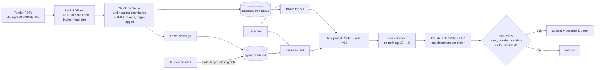

# DocIntel

Answers questions about Indian government tender documents (notices inviting tender,
bid documents, corrigenda) **with citations to the page**, **refuses** when the documents
don't support an answer, and **measures** how well it does both.

**Stack:** Python 3.12 · FastAPI · PostgreSQL + pgvector (HNSW) · Elasticsearch (BM25) ·
sentence-transformers / PyTorch (multilingual-e5-small, MiniLM cross-encoder) ·
Claude (Citations API) · Tesseract OCR via ocrmypdf · Docker

It is the companion to [TenderLens](../tenderlens): TenderLens finds the tender,
DocIntel reads its documents. Tender metadata (state, buyer, closing date) comes from the
TenderLens API and is used as retrieval filters.

```
make up        # API on :8100 (shares TenderLens's Postgres and Elasticsearch)
make ingest    # PDFs under data/pdfs/<TENDER_ID>/ -> chunks, embeddings, BM25 index
make eval      # retrieval benchmark
```

## Results

<!-- RESULTS:START -->
<!-- RESULTS:END -->

## How it works



### Ingestion
* **Idempotent.** A file is identified by its SHA-256, so re-running, renaming or copying
  a file never creates a duplicate. Postgres and Elasticsearch are written in one
  transaction, so they cannot disagree.
* **Text, then OCR where needed.** PyMuPDF reads the text layer. A page goes to OCR
  (ocrmypdf + Tesseract, English and Hindi) when it is a scan (images, almost no text)
  *or* when its Hindi text layer is garbage. Many Indian PDFs map Devanagari conjuncts
  to stray code points ("निविदा" extracts as "न ȡ व ȡ दा"); DocIntel detects this by the
  share of Latin-Extended / private-use characters among Devanagari ones.
* **Clean-up that changes retrieval.** NFKC normalisation turns PDF ligatures back into
  letters: "financial" and "office" are unmatchable by BM25 otherwise. Words hyphenated
  across a line break are rejoined, and running headers/footers (lines repeating on most
  pages, digits ignored) are dropped so they don't split sentences at page breaks.
* **Chunks follow the document's structure**: numbered clauses ("4.2 Turnover") and
  uppercase headings start sections; sections are packed to ~500 tokens (max 800), long
  ones split on sentences with 60-token overlap and the heading repeated. Each chunk
  keeps its page range for citations.

### Retrieval
BM25 catches exact tokens (tender IDs, clause numbers, "EMD") that embeddings blur;
embeddings catch paraphrases ("bid security" ≈ "earnest money") that BM25 misses. Both
return 50 candidates; Reciprocal Rank Fusion (k = 60) merges them using ranks only, so
BM25 scores and cosine similarities never need a common scale. A cross-encoder
(ms-marco-MiniLM-L-6-v2) re-scores the top 30 and keeps 5. Filters (tender, state,
closing date) apply to both sides; pgvector's iterative HNSW scan keeps filtered dense
search from returning fewer than k rows.

### Grounded answers
* Each of the 5 chunks is sent to Claude (`claude-opus-5-5`) as its **own document with
  citations enabled**, titled "file.pdf, p. 3". Every citation in the answer therefore
  points at exactly one chunk, and its `cited_text` is the sentence relied on.
* The system prompt: cite everything, copy values exactly, never calculate, and reply
  with one exact sentence when the documents don't answer.
* **Post-check** (`docintel/grounding.py`): every amount, percentage, date and number in
  the answer must appear in the passages it cites, after normalisation ("₹16 lakh" =
  "16,00,000", "7 October 2026" = "07-Oct-2026"). A value-bearing sentence without a
  citation, or a value the sources don't contain (including a computed one), rejects
  the whole answer. Same idea as CONTROL ARM's grounded-language invariant.
* `POST /ask` streams Server-Sent Events: retrieval, text deltas, citations, then one
  `final` event with the checked result. The streamed text is a draft until `final`; a
  rejected draft is replaced in the UI.
* Server-side refusal fallbacks (`fallbacks: "default"`) are on; adaptive thinking at
  an explicit effort level.

### Evaluation
`docintel/evaluate.py`, questions in `data/eval/questions.jsonl`:
* **Retrieval:** recall@5 and MRR@10 for bm25, dense, hybrid and hybrid+rerank, both
  *scoped* (the question's tender only, like asking from a tender's page) and *global*
  (all documents, the question names the work).
* **Answers** (needs an API key): exact match on the expected values, grounding rate,
  abstention accuracy on questions the documents can't answer, and "confident wrong"
  answers, the number that matters most.
* A chunk counts as relevant when it contains all of the question's evidence fragments,
  so labels survive re-chunking.

### Fine-tuning the retriever
`docintel/finetune.py`: multilingual-e5-small, MultipleNegativesRankingLoss, one hard
negative per pair from BM25's top results within the same tender that do not contain
the answer. It trains on one set of tenders and is measured on the others, with different
question wording for training and test, and reports before/after on the same chunks.

## API

| Endpoint | |
|---|---|
| `POST /ask` `{question, tender_id?, state?, closes_after?}` | SSE stream: `retrieval`, `delta`, `citation`, `final`. `?stream=false` returns JSON |
| `GET /search?q=&mode=&tender_id=&k=` | Retrieval only, any mode |
| `GET /documents?tender_id=` | Ingested documents with page and chunk counts, OCR use |
| `GET /health` | Database and Elasticsearch status |
| `GET /` | A small page for asking questions |

## Data

Put PDFs in `data/pdfs/<TENDER_ID>/` (see `data/pdfs/README.md`). The portal's document
downloads are CAPTCHA-protected, so collecting them is manual by design.

`data/pdfs/synthetic/` holds **30 generated notices** used for development and the
benchmark until enough real documents are collected. Each is built from a real tender in
TenderLens (ID, title, buyer, value, EMD, dates) plus generated clauses and boilerplate
full of distractor numbers. 8 are bilingual, and 3 have a scanned page. Every page
carries "SYNTHETIC TEST DOCUMENT". Synthetic text is more regular than real notices, so
treat the numbers below as an upper bound, and re-run `make eval` on real documents with
hand-written questions before quoting them.
